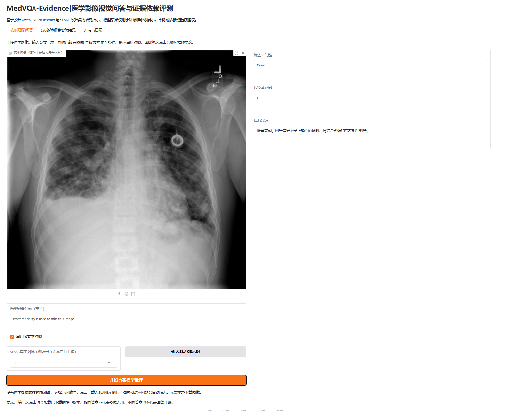
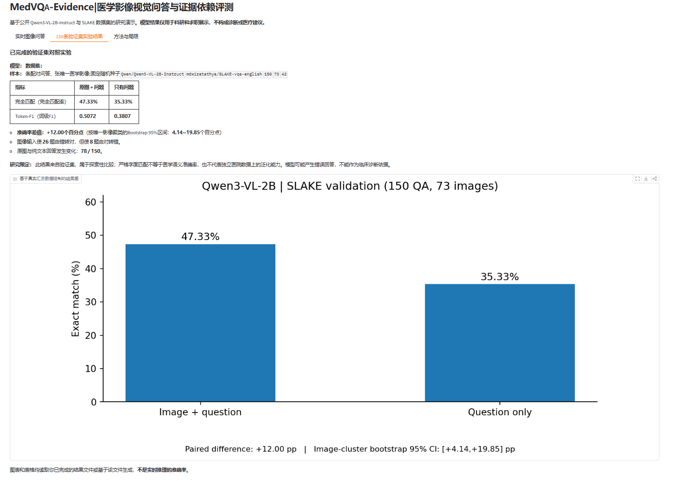
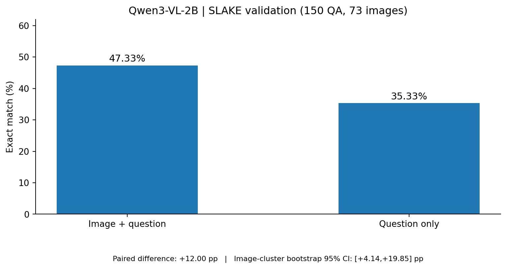

# MedVQA-Evidence｜医学影像视觉问答与视觉依赖评测

> **Qwen3-VL-2B-Instruct + SLAKE + 配对消融实验 + Gradio**  
> 研究问题：**医学视觉语言模型在回答医学影像问题时，真实图像是否比仅输入问题文字带来额外预测增益？**



## 整理后的使用入口

两个原文件夹已合并到 `MedVQA_Evidence/`：以 Release 中的最终评测和展示为主，补入 MVP 的探索汇总；同内容源码不重复上传。原始 MVP 完整快照、逐题复核记录及个人编辑文件留在被 Git 忽略的本机 `.local_archive/`，不进入公开仓库。

- `python app.py --check`：离线读取150条汇总，不需要 GPU 或模型权重。
- `python app.py`：启动最终演示页；点击示例时读取/下载 SLAKE，点击推理时加载/下载模型。
- `python evaluate.py --limit 150`：最终配对评测，仅允许 validation，默认种子42。
- `day4_evaluate.py`、`day5_app.py` 保留兼容入口；早期三组探索命令移到 `archive/`。
- `python -m unittest discover -s tests -v`：离线测试，覆盖指标、统计边界、配对完整性和重复记录检查。

整理过程与验证范围见 [MERGE_REPORT](docs/MERGE_REPORT.md)；旧 README 作为历史资料保存在 `docs/history/`，其中“尚未部署”等状态不代表当前项目。

## 1. 项目亮点

- **真实开源权重推理**：使用 `Qwen/Qwen3-VL-2B-Instruct`，基于 PyTorch / Transformers 实现医学影像视觉问答，不依赖外部付费API。
- **严谨的配对对照**：同一道问题同时评估「图像+问题」与「仅问题」；固定随机种子 `42`。
- **防止虚假泛化**：对训练、验证、测试进行图像内容哈希交叉审计；此次用户运行报告交叉计数均为 0（仅涵盖完全一致的图像）。
- **考虑数据相关性**：150条问答来自73张唯一图像，按图像分簇进行Bootstrap不确定性估计。
- **可视化工程交付**：Gradio网页支持SLAKE真实示例、一键加载医学图像、文字对照、统计结果页。

## 2. 真实实验结果（SLAKE **验证集**，非测试集）

| 指标 | 图像 + 问题 | 只有问题 |
|---|---:|---:|
| 问答数 | 150 | 150 |
| 唯一图像数 | 73 | 73 |
| Exact Match（规范化完全匹配率） | **47.33%（71/150）** | **35.33%（53/150）** |
| Token-F1（词级F1） | **0.5072** | **0.3807** |

- EM绝对增益：**+12.00个百分点**；图像簇Bootstrap 95%置信区间：**[+4.14, +19.85]个百分点**。
- Token-F1增益：**+0.1265**；图像簇Bootstrap 95%区间：**[+0.0497, +0.2008]**。
- 配对表现：**26题**由错变对，**8题**由对变错；**78/150**次回答文字发生变化。
- 150/150问答完成配对，预测缺失数为0。原始汇总字段保存在 [`results/day4_validation_summary.json`](results/day4_validation_summary.json)。





**解释边界**：该实验表明，在当前SLAKE验证集和字面评测指标下，图像输入提供了正向预测增益；不等于具备临床诊断可靠性。`axial` 与 `Transverse Plane` 这类同义答案可能被严格EM误判。尚未完成正式独立测试集和跨医院验证；统计区间为探索性结果。方法及限制详见 [`docs/EXPERIMENT_REPORT.md`](docs/EXPERIMENT_REPORT.md)。

## 3. 技术栈

| 技术 | 用途 |
|---|---|
| Python / PyTorch | 模型推理计算（部署已在RTX 4090 D验证） |
| Hugging Face Transformers | 加载Qwen3-VL-2B模型与多模态处理器 |
| Hugging Face Datasets | 获取并读取SLAKE英文版影像问答数据 |
| pandas / numpy | 整理评测结果 |
| Bootstrap（自助抽样） | 图像级聚类置信区间估计 |
| Gradio | 实时问答、仅文本消融、结果展示 |
| Git / GitHub | 代码版本管理与项目展示 |

## 4. 目录结构

```text
MedVQA_Evidence/
├── medvqa.py                 # 数据读取、模型推理、答案规范化与指标
├── preflight.py              # 数据下载与图像内容哈希审计
├── evaluate.py               # 最终150条图像/文本配对评测与图像聚类Bootstrap
├── app.py                    # 最终Gradio演示，内置SLAKE示例
├── day4_evaluate.py          # 兼容旧评测命令，转到 evaluate.py
├── day5_app.py               # 兼容旧网页命令，转到 app.py
├── archive/                  # 早期基础网页与三组探索脚本
├── requirements.txt
├── results/
│   ├── day4_validation_summary.json  # 150条验证集核心汇总
│   └── exploratory_50_summary.json   # 早期50条三组探索汇总，单独解释
├── figures/                  # 结果图
├── assets/                   # 项目演示截图
├── docs/                     # 方法报告、复现与简历说明
└── tests/                    # 自动化单元测试
```

## 5. 快速运行

既有实验报告记录了 AutoDL 的 **RTX 4090 D、Python 3.12.3、PyTorch 2.5.1+cu124** 运行环境。本次整理仅执行离线代码、统计与页面构建检查，未重新下载数据/模型、未重跑 GPU 推理或完整数据集哈希审计。

```bash
# 1. 进入工程（不要修改已正常工作的GPU版torch）
cd MedVQA_Evidence

# 2. 安装Python依赖，首次会额外下载数据与模型权重
python -m pip install -r requirements.txt

# 3. 预检查：支持检查三个split之间的相同图像
python preflight.py --exhaustive

# 4. 离线检查演示程序能读取汇总结果
python app.py --check

# 5. 启动网页（需GPU运行模型）
python app.py
```

在AutoDL平台使用实例的**7860端口映射**打开网页。内置SLAKE示例可直接加载影像，无需自行寻找PNG文件；点击“开始真实模型推理”，查看有图像及无图像两种回答。模型首次加载或云端网络下载可能较慢。

### 复现150条验证集对照

```bash
python evaluate.py --limit 150
# 若推理文件已存在，可只根据现有记录重建报告
python evaluate.py --limit 150 --report-only
```

**注意**：本代码仓库仅公开汇总指标，不随仓库分发原始逐题模型预测。运行完整评测需要重新在相同模型/数据/环境条件下计算。`--report-only` 不加载模型，但仍需加载 SLAKE 来核验已有记录，因此需要可用的数据缓存或网络；仓库只有汇总 JSON，不能直接重建150条逐题记录。验证集结果不能写成测试集结果。

### 本地离线单元测试

```bash
python -m unittest discover -s tests -v
```

## 6. 一张图的演示示例

示例问题：`What modality is used to take this image?`  
标准答案：`X-Ray`  
本次实际演示结果：**图像输入 → `X-ray`**，**仅文本 → `CT`**。

这说明在**这一道题**上图像信息改变了预测并使答案与标签一致；单题不能代表整体性能，也不能证明临床医学推理能力。

## 7. 结果可信度与局限

1. SLAKE同一医学影像可被多道问题复用：按图像分簇进行Bootstrap，不能把150条问题误称为150名患者。
2. 跨train/validation/test的图像哈希交叉均为0，是用户在AutoDL上的审计输出；这一结果不排除**相似影像、模型预训练污染或语义重复**。
3. 当前**严格EM是标准化字面匹配，不等同医学语义正确率**；尚未系统性人工复核医学同义词及可能错误标签。
4. Day2随机`wrong_image`条件缺少可溯源图像编号，故不作为Day4核心统计证据。
5. 未进行疾病筛查临床验证，未开发目标检测或像素级分割功能，不可作为医疗建议。

## 8. 公开数据与模型引用 / 版权说明

- 模型：[Qwen3-VL-2B-Instruct](https://huggingface.co/Qwen/Qwen3-VL-2B-Instruct) / [源码](https://github.com/QwenLM/Qwen3-VL)，遵守模型仓库的授权条款。
- 实际评测使用的SLAKE英文整理版：[mdwiratathya/SLAKE-vqa-english](https://huggingface.co/datasets/mdwiratathya/SLAKE-vqa-english)。
- SLAKE原始数据由 **Bo Liu、Xiao-Ming Wu 等**发布，[官方项目](https://www.med-vqa.com/slake/)与[BoKelvin/SLAKE](https://huggingface.co/datasets/BoKelvin/SLAKE)。原始数据集标示为 **CC BY 4.0**，项目演示截图中的SLAKE影像为公开数据的教学科研使用，引用和改编应遵守原始作者署名要求。
- 不提交完整模型权重、SLAKE原始数据集、私有医疗影像、缓存文件或未筛选的原始实验日志。

**免责声明**：本项目仅供方法研究、技术展示和求职作品集使用，不提供诊断或治疗建议。


## 9. 早期50条探索实验

MVP 额外保留了一份聚合统计，现归入 [exploratory_50_summary.json](results/exploratory_50_summary.json)：50条验证集问答、43张唯一图像；Image / Text-only / Wrong-image 的 EM 分别为 44% / 32% / 30%。Image 对 Text-only 的图像簇 Bootstrap 95%区间为 [-1.92, 24.49] 个百分点，包含0，不能按此批结果宣称稳定正向效果。

这份结果与核心的150条/73张图像汇总属于不同阶段，不能混用样本数或置信区间。早期 Wrong-image 没有记录替换影像来源；旧逐题复核 CSV 只保留在本机，公开仓库不提供该早期统计区间的完整生成过程，也不把它当作150条结论的额外独立证据。

## 10. 复现与当前限制

- `requirements.txt` 保留原有依赖范围，未提供完全锁定的 CUDA 环境；PyTorch 应使用已有兼容 GPU 版本。当前 `VQAPredictor` 明确要求 CUDA，CPU 机器可运行离线测试和摘要检查，不能直接执行真实模型推理。
- 图像哈希交叉为0是既有运行报告记载；本次两个文件夹未包含审计原始输出或完整数据，本次未独立复核此结论。
- 150条结果保留原汇总值；本次只核对其样本数、配对转移和增益的内部一致性，没有重算其 Bootstrap 区间。
- 修正了百分位数辅助函数在单元素样本和最大分位点返回0的边界错误，历史汇总文件未改写。
- 早期原型的设计文档和逐题记录不作为最终运行入口；当前评测不包含微调、RAG、检测、分割或临床验证。
