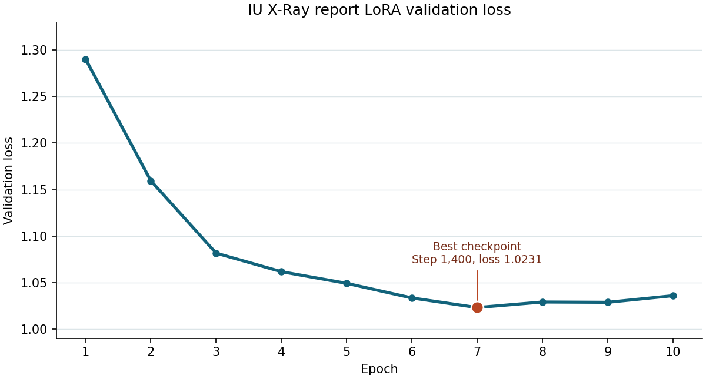
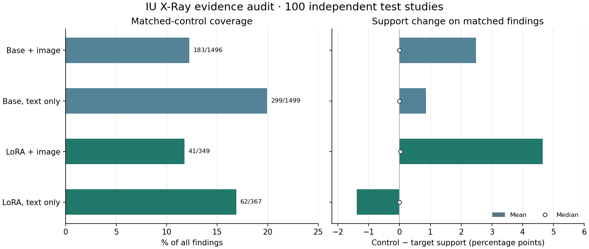

# IU X-Ray 胸片报告生成与证据审计

在同一批胸片上对照 **Base／LoRA × 看图／仅文本**四组报告。MAIRA-2 定位报告短语，反事实审计比较原图、目标模糊与同面积对照。 [复现报告](REPRODUCTION.md) · [结果索引](results/)

## 先打开 100 例报告网页

用 VS Code 或 PyCharm 打开整个 `MedVQA_Evidence` 仓库，把 Python 解释器选为仓库里的 `.venv\Scripts\python.exe`。已有本机报告归档时，在仓库根目录运行下方命令。首次克隆时，按第 1–3 节准备数据和生成报告后再打开网页。

```powershell
python -m cxr_report_evidence.web --local-results
```

打开 [报告与证据审计示例](http://127.0.0.1:8010/?study=iu-CXR227)。在「证据审计」选 LoRA 和「原图＋文本」，点击 `The heart is enlarged.` 后，可查看候选框、两种模糊图和分数。同一页也展示四组英文报告和参考 Findings。只看知识检索时，运行 `python -m cxr_report_evidence.web`。

## 1. 安装环境、检查数据

首次使用先看 [本机环境准备](../evidence/README.md)。然后运行：

```powershell
python -m pip install -r cxr_report_evidence/requirements.txt
python -m cxr_report_evidence check
```

已有清单时，`check` 应显示训练 1,600、验证 100、测试 100。首次复现时，将 XML 包、PNG 包和正位名单保存到 `cxr_report_evidence/artifacts/data/cxr-openi/`，将 PNG 解压到其中的 `images/`。 [XML 包](https://openi.nlm.nih.gov/imgs/collections/NLMCXR_reports.tgz) · [PNG 包](https://openi.nlm.nih.gov/imgs/collections/NLMCXR_png.tgz) · [正位名单](https://raw.githubusercontent.com/farrell236/RATCHET/master/preprocessing/openi/view_frontal.txt)

```powershell
python -m cxr_report_evidence prepare-openi
```

## 2. 训练 LoRA

这一步需要本机 CUDA。已有正式适配器可以跳过。输出在 `cxr_report_evidence/artifacts/checkpoints/local-lora/`。

```powershell
python -m cxr_report_evidence train --epochs 10 --early-stopping-patience 3 --use-indication
```

**实测** 1,600 例训练 10 轮、2,000 步，选中第 1,400 步的适配器，验证损失 1.0231。 [训练摘要](results/lora_training.json)



## 3. 生成报告和算分

已经有 100 例 GPU 结果时，可以直接打开网页或做审计。要重新生成，在本机 CPU 上运行第一行。用 CUDA 时把 `cpu` 改成 `cuda`。

```powershell
python -m cxr_report_evidence generate --device cpu --use-indication
python -m cxr_report_evidence metrics
```

生成会找本机新训练的适配器，再找归档适配器。新报告写到 `cxr_report_evidence/artifacts/results/local-test/reports.json`。中断后重跑原命令。算分优先读本机新报告，否则读取 100 例 GPU 归档，在报告旁写出 `report-metrics-local.json`。

| 100 例独立测试 · ROUGE-L F1 | 原图＋文本 | 仅文本 |
| --- | ---: | ---: |
| Base | 0.1159 | 0.1194 |
| 正式 LoRA | **0.3024** | **0.2638** |

在同样看图时，LoRA 有 95/100 例得分更高。同样用 LoRA 时，加图平均提高 0.0386。此处衡量英文报告与参考 Findings 的文本重合。 [完整测试汇总](results/test100_gpu_metrics.json)

## 4. 做证据审计

在 AutoDL 的 Linux 终端运行时，使用 [100 例 GPU 审计命令](REPRODUCTION.md#61-在-autodl-上直接接着审计-100-例)。

第一行用 MAIRA-2 环境定位短语。第二和第三行在当前 IDE 终端执行，生成模糊对照和汇总。默认优先用本机新报告，再用 100 例 GPU 归档。MAIRA-2 定位需单独安装权重和 CUDA 环境。 [MAIRA-2 环境准备](../evidence/README.md#maira-2-环境)

```powershell
.\.venv-maira\Scripts\python.exe -m cxr_report_evidence ground --max-findings 4
python -m cxr_report_evidence probe --device cpu
python -m cxr_report_evidence summarize-probes
```

三条命令分别输出 `ground.json`、`probes.json` 和 `probe-summary.json`。100 例 GPU 批次已有这三份文件。网页读取对应 `reports.json` 旁边的 `probes.json`。

### 100 例审计实测

共记录 **3,711** 条发现。按每份报告最多考察前 4 条及非局部陈述过滤规则筛选，**1,084** 条进入定位，**738** 条生成候选框，**585** 条取得了匹配对照和核查分数。100 个病例各有至少一条有效对照。

| 报告组 | 有效对照／全部发现 | 覆盖率 | 对照支持分减目标支持分 · 均值 |
| --- | ---: | ---: | ---: |
| Base 看图 | 183／1,496 | 12.23% | +0.0249 |
| Base 仅文本 | 299／1,499 | 19.95% | +0.0086 |
| LoRA 看图 | 41／349 | 11.75% | +0.0465 |
| LoRA 仅文本 | 62／367 | 16.89% | −0.0138 |

覆盖率以各组全部发现为分母。差值仅在有匹配对照的条目上计算，四组的中位数均接近 0。LoRA 看图组均值为正，平均而言，模糊 MAIRA-2 指定区域比模糊对照区域更影响 Qwen 核查器的支持分。各组进入定位和核查的条目不同，数据也缺少人工视觉支持标签，所以这张表用于描述模型反应。 [正式审计汇总](results/test100_gpu_audit.json) · [详细口径及病例](REPRODUCTION.md#06-正式批量反事实审计)



网页截图可用允许公开的示例制作。 [Open-i 数据说明](https://openi.nlm.nih.gov/faq#collection)

<!--  -->
<!--  -->
